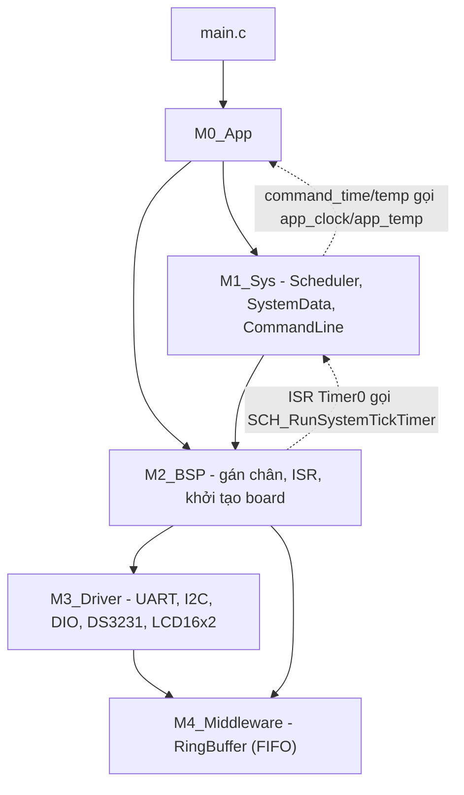

# Đồng hồ thời gian thực ATmega324P – DS3231 – LCD16x2 – UART

Firmware cho **ATmega324P/PA @ 8 MHz**. Thiết bị đọc giờ từ **DS3231** qua I²C, hiển thị lên **LCD 16×2** (chế độ 4-bit), điều khiển một **LED** và nhận lệnh từ máy tính qua **UART0 9600 8N1**.

Phần mềm dùng **Cooperative Scheduler** (bộ lập lịch hợp tác, tick 1 ms) và các tác vụ viết theo kiểu **co-routine**. Vòng lặp chính không có `_delay_ms`.

Đặc tả gốc: [BTL_ATmega324_DS3231_LCD_UART.docx](BTL_ATmega324_DS3231_LCD_UART.docx).

---

## Mục lục

1. [Tính năng](#1-tính-năng)
2. [Phần cứng và sơ đồ chân](#2-phần-cứng-và-sơ-đồ-chân)
3. [Kiến trúc phần mềm](#3-kiến-trúc-phần-mềm)
4. [Cấu trúc thư mục](#4-cấu-trúc-thư-mục)
5. [Bộ lập lịch và các tác vụ](#5-bộ-lập-lịch-và-các-tác-vụ)
6. [Giao thức UART](#6-giao-thức-uart)
7. [Màn hình LCD](#7-màn-hình-lcd)
8. [Biên dịch](#8-biên-dịch)
9. [Nạp chương trình và mô phỏng](#9-nạp-chương-trình-và-mô-phỏng)
10. [Kịch bản kiểm thử](#10-kịch-bản-kiểm-thử)
11. [Tham số cấu hình](#11-tham-số-cấu-hình)
12. [Hạn chế đã biết](#12-hạn-chế-đã-biết)

---

## 1. Tính năng

| Mã | Yêu cầu | Trạng thái | Module chính |
|---|---|---|---|
| FR-01 | Đọc DS3231 định kỳ ≤ 500 ms | Có (250 ms) | `app_clock` |
| FR-02 | LCD hiển thị ngày/giờ, chỉ ghi ký tự thay đổi | Có | `app_lcd`, `lcd16x2` |git 
| FR-03 | Nhận lệnh UART và phản hồi đúng khung | Có | `app_console`, `command` |
| FR-04 | LED ON / OFF / BLINK chu kỳ 10–5000 ms | Có | `app_led`, `command_led` |
| FR-05 | Đọc giờ/ngày (`TIME?`, `DATE?`, `DT?`) | Có | `command_time` |
| FR-06 | Ghi giờ/ngày xuống DS3231 | Có | `command_time`, `app_clock` |
| FR-07 | Kiểm tra tham số, trả mã lỗi E01–E08 | Có | `command*` |
| FR-08 | LCD hiển thị trạng thái LED (`L:ON/OFF/BLK`) | Có | `app_lcd` |
| FR-09 | Phát hiện lỗi I²C, báo `RTC ERROR` lên LCD và UART | Có | `bsp_ds3231`, `app_lcd` |
| FR-10 | Đọc nhiệt độ DS3231 (`TEMP?`) | Có | `app_temp`, `command_temp` |
| FR-11 | Lệnh `HELP` | Có | `command` |
| FR-12 | Báo thức Alarm 1 | `ds3231`, `app_clock` |

---

## 2. Phần cứng và sơ đồ chân

Định nghĩa chân nằm trong [src/dev/M2_BSP/board.h](src/dev/M2_BSP/board.h).

| Ngoại vi | Tín hiệu | Chân ATmega324P | Ghi chú |
|---|---|---|---|
| LED | LED | `PB0` | Tích cực mức cao |
| UART0 | RXD0 | `PD0` | 9600 bps, 8N1 |
| UART0 | TXD0 | `PD1` | |
| I²C (TWI) | SCL | `PC0` | 100 kHz, cần trở kéo lên |
| I²C (TWI) | SDA | `PC1` | |
| LCD 16×2 | RS | `PA0` | |
| LCD 16×2 | EN | `PA1` | |
| LCD 16×2 | D4–D7 | `PA4`–`PA7` | Chế độ 4-bit, nối RW xuống GND |
| DS3231 | Địa chỉ I²C | `0x68` | Byte địa chỉ `0xD0` (ghi) / `0xD1` (đọc) |

- **Xung nhịp:** 8 MHz (`F_CPU = 8000000UL`). Cấu hình fuse sao cho MCU chạy đúng 8 MHz, không bật chia 8 (`CKDIV8`).
- **Pin backup DS3231:** cần có để giờ được giữ khi mất nguồn.

---

## 3. Kiến trúc phần mềm

Mã nguồn chia thành 5 tầng. Tầng trên chỉ gọi tầng dưới, trừ hai ngoại lệ có chủ đích (mũi tên nét đứt).



| Tầng | Vai trò |
|---|---|
| **M0_App** | Logic ứng dụng. Mỗi module có một hàm `*_Task()` là co-routine được scheduler gọi định kỳ. |
| **M1_Sys** | `Scheduler` (tick 1 ms, soft timer), `SystemData` (bảng dữ liệu dùng chung), `CommandLine` (phân tích và thực thi lệnh). |
| **M2_BSP** | Gắn driver với board cụ thể: chân, tần số, kích thước FIFO và các ISR (`TIMER0_COMPA`, `USART0_RX`, `USART0_UDRE`). |
| **M3_Driver** | Driver chỉ dùng thư viện AVR và `M4_Middleware`. |
| **M4_Middleware** | FIFO và sử dụng (`ATOMIC_BLOCK`). |

**Quy tắc dữ liệu dùng chung:**

- `SystemData` chỉ được truy cập trong main loop, không ISR nào can thiệp đến.
- Giữa ISR và main chỉ có biến của Scheduler và FIFO UART. Cả hai đều khai báo `volatile` và được đọc/ghi trong `ATOMIC_BLOCK`.


---

## 4. Cấu trúc thư mục

```text
atmega_ds3231_makefile/
├── Makefile                      # Build: kết quả .o .d .elf .hex .map nằm trong Debug/
├── BTL_ATmega324_DS3231_LCD_UART.docx
├── Debug/                        # Thư mục kết quả build
└── src/
    ├── main.c                    # Gọi APP_main()
    └── dev/
        ├── M0_App/
        │   ├── app_main.c/h      # APP_Init, bảng task, vòng lặp chính
        │   ├── app_console.c/h   # UART RX/TX và bộ gom dòng lệnh
        │   ├── app_clock.c/h     # Đọc/ghi DS3231
        │   ├── app_temp.c/h      # Đọc nhiệt độ DS3231
        │   ├── app_led.c/h       # LED ON/OFF/BLINK 
        │   └── app_lcd.c/h       # Cập nhật màn hình, chỉ cập nhật ký tự thay đổi
        ├── M1_Sys/
        │   ├── Scheduler/        # scheduler.c/h, scheduler_define.h
        │   ├── SystemData/       # system_data.c/h
        │   └── CommandLine/      # cmdline.c/h, command.c/h, command_led/time/temp.c/h
        ├── M2_BSP/
        │   ├── board.h           # Gán chân, F_CPU, baud, tần số I2C
        │   ├── TIMER/            # Timer0 CTC 1 ms và ISR
        │   ├── UART/             # USART0, FIFO và ISR
        │   ├── DS3231/           # Chân TWI, theo dõi lỗi RTC
        │   ├── LCD/              # Chân LCD
        │   ├── LED/              # Chân LED
        │   └── I2C/              # bsp_i2c
        ├── M3_Driver/
        │   ├── Component/        # DIO, I2C, UART, UART0
        │   └── Devices/          # DS3231, LCD16x2
        └── M4_Middleware/
            └── FIFO/             # fifo.c/h
```

---

## 5. Bộ lập lịch và các tác vụ

**Cơ chế:**

1. Timer0 ngắt mỗi 1 ms.
2. ISR gọi `SCH_RunSystemTickTimer()`. Hàm này tăng `s_SystemTick`, đếm thời gian cho từng task và bật cờ `ready` khi đến hạn..
3. Main loop gọi `SCH_HandleScheduledTask()`. Hàm này lần lượt xoá cờ `ready` (trong `ATOMIC_BLOCK`) và gọi các task đến hạn.
4. Mỗi task chỉ chạy một lượt của máy trạng thái rồi `return` để nhường CPU.

Bảng task nằm trong [app_main.c](src/dev/M0_App/app_main.c):

| Task | Chu kỳ gọi | Pha ban đầu | Công việc |
|---|---|---|---|
| `AppConsole_Task` | 1 ms | 0 | Lấy ≤ 16 byte từ RX FIFO, gom dòng, thực thi lệnh, trả về phản hồi |
| `AppLed_Task` | 1 ms | 0 | Bật/tắt PB0 `SCH_TIM_LED` (sáng T/2, tắt T/2) |
| `AppLcd_Task` | 2 ms | 0 | Khởi tạo LCD, vẽ lại khi có thay đổi hoặc mỗi 250 ms, ghi ≤ 4 thao tác mỗi lần |
| `AppClock_Task` | 50 ms | 10 | Đọc thanh ghi DS3231 mỗi 250 ms|
| `AppTemp_Task` | 250 ms | 125 | Đọc nhiệt độ định kỳ |

---

## 6. Giao thức UART

### 6.1. Khung truyền

| Mục | Giá trị |
|---|---|
| Tham số | 9600 bps, 8N1, không điều khiển luồng |
| Kết thúc lệnh | `CR LF`, chỉ `LF`, hoặc chỉ `CR` |
| Độ dài tối đa | 48 ký tự, bao gồm kể cả ký tự kết thúc |
| Cú pháp lệnh | `<TEN_LENH>[,<tham_so_1>[,<tham_so_2>...]]` |
| Tên lệnh | Không phân biệt hoa/thường (`led,on` ≡ `LED,ON`) |
| Phản hồi OK | `+OK[,<du_lieu>...]\r\n` |
| Phản hồi lỗi | `-ERR,<ma_loi>,<mo_ta>\r\n` |

### 6.2. Tập lệnh

| Lệnh | Phản hồi thành công | Lỗi có thể có |
|---|---|---|
| `PING` | `+OK,PONG` | E02 |
| `ID?` | `+OK,ATMEGA324-RTC,V1.0` | E02 |
| `HELP` | Danh sách lệnh, nhiều dòng, kết thúc bằng `+OK,END` | E02 |
| `LED,ON` | `+OK,LED,ON` | E02, E03 |
| `LED,OFF` | `+OK,LED,OFF` | E02, E03 |
| `LED,BLINK,<T>` | `+OK,LED,BLINK,<T>` (T = 10..5000 ms) | E02, E03, E04 |
| `LED?` | `+OK,LED,ON` / `+OK,LED,OFF` / `+OK,LED,BLINK,<T>` | E02 |
| `TIME?` | `+OK,TIME,hh:mm:ss` | E02, E05 |
| `DATE?` | `+OK,DATE,dd/mm/yyyy,DOW` | E02, E05 |
| `DT?` | `+OK,DT,dd/mm/yyyy,hh:mm:ss,DOW` | E02, E05 |
| `TIME,hh:mm:ss` | `+OK,TIME,hh:mm:ss` | E02, E03, E04, E05 |
| `DATE,dd/mm/yyyy,DOW` | `+OK,DATE,dd/mm/yyyy,DOW` | E02, E03, E04, E05, E07 |
| `DT,dd/mm/yyyy,hh:mm:ss,DOW` | `+OK,DT,dd/mm/yyyy,hh:mm:ss,DOW` | E02, E03, E04, E05, E07 |
| `TEMP?` | `+OK,TEMP,<val>,C` (ví dụ `28.25`) | E02, E05 |

- `DOW` là một trong `MON TUE WED THU FRI SAT SUN`.
- Năm hợp lệ là 2000–2099.
- `DT,...` kiểm tra toàn bộ tham số trước khi ghi. Nếu một tham số sai thì không ghi gì xuống DS3231.

### 6.3. Mã lỗi

| Mã | Phản hồi | Nguyên nhân |
|---|---|---|
| E01 | `-ERR,E01,UNKNOWN COMMAND` | Tên lệnh không có trong bảng lệnh |
| E02 | `-ERR,E02,WRONG PARAM COUNT` | Thiếu/thừa tham số, hoặc có ô rỗng (`PING,`, `LED,,ON`) |
| E03 | `-ERR,E03,PARAM OUT OF RANGE` | Giá trị ngoài khoảng, hoặc từ khoá LED không hợp lệ |
| E04 | `-ERR,E04,BAD FORMAT` | Sai định dạng (`14-30-05`) hoặc có ký tự không phải số |
| E05 | `-ERR,E05,RTC ERROR` | DS3231 không ACK hoặc giao dịch I²C bị timeout |
| E06 | `-ERR,E06,LINE TOO LONG` | Dòng vượt 48 ký tự, phần dư bị bỏ |
| E07 | `-ERR,E07,INVALID DATE` | Ngày không tồn tại (`31/02`, `29/02` năm không nhuận) |
| E08 | `-ERR,E08,BUSY` | Phản hồi trước (ví dụ `HELP`) chưa gửi xong |

### 6.4. Thêm lệnh mới

1. Viết handler có dạng `int Cmd_Xxx(CommandContext *ctx, int argc, char *argv[])`. Handler kết thúc bằng `Command_ReplyOk()` hoặc `Command_ReplyError()`.
2. Khai báo chuỗi tên lệnh với `CMD_TEXT_STORAGE` (lưu trong Flash).
3. Thêm một dòng vào `g_psCmdTable[]` trong [command.c](src/dev/M1_Sys/CommandLine/command.c).

---

## 7. Màn hình LCD

```text
col:     0123456789012345
Dòng 1:  26/08/2026  WED
Dòng 2:  14:30:05   L:BLK
```

- Dòng 2 hiển thị `L:ON`, `L:OFF` hoặc `L:BLK` tuỳ chế độ LED.
- Khi mất kết nối DS3231, dòng 2 hiển thị `RTC ERROR`.
- LCD dùng hai framebuffer (`target` và `shadow`). Mỗi lần cập nhật chỉ gửi các ký tự khác nhau, không xoá toàn màn hình, nên LCD không bị nhấp nháy.

---

## 8. Biên dịch

### 8.1. Yêu cầu

- **AVR-GCC**. Mặc định Makefile dùng toolchain của Microchip/Atmel Studio 7.0:
  `C:/Program Files (x86)/Atmel/Studio/7.0/toolchain/avr8/avr8-gnu-toolchain/bin`
- **GNU Make** (ví dụ `mingw32-make` của MinGW).

### 8.2. Lệnh

```powershell
# Biên dịch toàn bộ: kết quả nằm trong Debug/
mingw32-make

# Xoá các file đã build
mingw32-make clean

# Dùng toolchain ở vị trí khác
mingw32-make AVR_TOOLS_PATH="C:/avr-gcc/bin"
```

### 8.3. Kết quả trong `Debug/`

| File | Mô tả |
|---|---|
| `*.o` | Object của từng file `.c` |
| `*.d` | File phụ thuộc header, giúp tự build lại khi header đổi |
| `main.elf` | File thực thi, dùng để debug |
| `main.hex` | File Intel HEX để nạp chip hoặc chạy Proteus |
| `main.map` | Bản đồ bộ nhớ |

Cờ biên dịch chính: `-mmcu=atmega324p -DF_CPU=8000000UL -Os -std=gnu11 -Wall -Wextra -ffunction-sections -fdata-sections`. Liên kết dùng `-Wl,--gc-sections`.

---

## 9. Nạp chương trình và mô phỏng

### 9.1. Proteus

1. Đặt ATmega324P với clock **8 MHz**. Trong mục *Program File*, chọn `Debug/main.hex`.
2. Nối DS3231, LCD 16×2 (LM016L) và LED theo [bảng chân](#2-phần-cứng-và-sơ-đồ-chân). Thêm trở kéo lên cho SCL/SDA.
3. Nối **Virtual Terminal** vào PD0/PD1 với cấu hình 9600 8N1. Virtual Terminal gửi `CR` khi nhấn Enter, và firmware đã chấp nhận `CR` làm ký tự kết thúc dòng.


### 9.2. Terminal trên máy tính

Có thể dùng PuTTY, Termite, Hercules hoặc Arduino Serial Monitor, cấu hình 9600 8N1 và **gửi kèm CR LF**.

---

## 10. Kịch bản kiểm thử

Theo mục 6 của đặc tả:

```text
PC  -> PING                         MCU <- +OK,PONG
PC  -> DT,26/08/2026,14:29:55,WED   MCU <- +OK,DT,26/08/2026,14:29:55,WED
PC  -> TIME?                        MCU <- +OK,TIME,14:30:02
PC  -> LED,ON                       MCU <- +OK,LED,ON           (LCD: L:ON)
PC  -> LED,BLINK,200                MCU <- +OK,LED,BLINK,200    (LCD: L:BLK)
PC  -> LED?                         MCU <- +OK,LED,BLINK,200
PC  -> TIME?                        MCU <- +OK,TIME,14:30:31    (đồng hồ vẫn chạy khi LED nháy)
PC  -> LED,OFF                      MCU <- +OK,LED,OFF
PC  -> TIME,99:99:99                MCU <- -ERR,E03,PARAM OUT OF RANGE
PC  -> BLINK,500                    MCU <- -ERR,E01,UNKNOWN COMMAND
PC  -> TEMP?                        MCU <- +OK,TEMP,29.00,C
```

Các trường hợp lỗi nên thử thêm:

```text
DATE,31/02/2026,SUN   -> -ERR,E07,INVALID DATE
DATE,29/02/2027,MON   -> -ERR,E07,INVALID DATE
TIME,14-30-05         -> -ERR,E04,BAD FORMAT
LED,BLINK,abc         -> -ERR,E04,BAD FORMAT
LED,BLINK,9000        -> -ERR,E03,PARAM OUT OF RANGE
PING,1                -> -ERR,E02,WRONG PARAM COUNT
<dòng dài hơn 48 ký tự> -> -ERR,E06,LINE TOO LONG
TIME?   -> -ERR,E05,RTC ERROR   (LCD: RTC ERROR)
```

**Kiểm thử mất nguồn:** sau khi cài giờ, ngắt nguồn 5 V khoảng 30 giây rồi cấp lại. Giờ trên LCD phải tiếp tục đúng nhờ pin backup của DS3231.

---

## 11. Tham số cấu hình

| Hằng số | Giá trị | File |
|---|---|---|
| `F_CPU` | `8000000UL` | `M2_BSP/board.h`, `Makefile` |
| `UART_XTP_BAUD` | `9600UL` | `M2_BSP/board.h` |
| `TWI_SCL_FREQ_HZ` | `100000UL` | `M2_BSP/board.h` |
| `BSP_UART0_RX_FIFO_SIZE` / `TX_FIFO_SIZE` | `64` / `64` byte | `M2_BSP/UART/bsp_uart.c` |
| `APP_CONSOLE_TX_FIFO_SIZE` | `96` byte (FIFO trung gian) | `M0_App/app_console.h` |
| `COMMAND_MAX_LINE_LENGTH` | `48` | `M1_Sys/CommandLine/command.h` |
| `COMMAND_FIRMWARE_ID` | `"ATMEGA324-RTC,V1.0"` | `M1_Sys/CommandLine/command.h` |
| `SYSTEM_DATA_BLINK_MIN/MAX/DEFAULT_MS` | `10` / `5000` / `1000` | `M1_Sys/SystemData/system_data.h` |
| `APP_CLOCK_RTC_POLL_MS` | `250` | `M0_App/app_clock.h` |
| `APP_TEMP_POLL_PERIOD_MS` | `1000` | `M0_App/app_temp.h` |
| `APP_LCD_REFRESH_PERIOD_MS` | `250` | `M0_App/app_lcd.h` |
| `APP_MAIN_*_PERIOD_MS` | 1 / 1 / 2 / 50 / 250 | `M0_App/app_main.h` |
| `MAX_TASKS` | `5` | `M1_Sys/Scheduler/scheduler_define.h` |

---

## 12. Hạn chế đã biết
- **SRAM:** dùng khoảng 72.1 %, phần còn lại cho stack khá hẹp. `Command_ExecuteLine()` cấp phát khoảng 150 byte trên stack.


